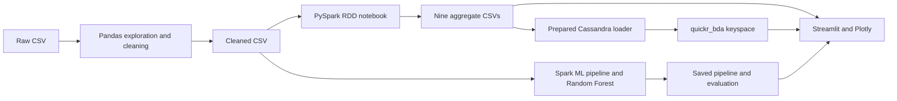

# Quickr — Food Delivery Analytics and Prediction System

Academic Big Data Analytics project in the existing **BDA LA** workspace. Quickr explores
food-delivery data, validates routes, computes PySpark RDD MapReduce summaries, stores
those summaries in Cassandra, and estimates delivery duration with a Random Forest.

## Actual results and current status

- Raw dataset: 45,593 records; cleaned dataset: 41,522 records and 37 columns.
- Nine executed PySpark CSV summaries contain 39 aggregate records.
- Average cleaned delivery duration: 26.315447 minutes; 29.967246% exceed 30 minutes.
  This is an analytical threshold, not actual lateness.
- PySpark MLlib held-out MAE: 3.213796 minutes; RMSE: 4.058517 minutes; R-squared: 0.814682.
- Preserved scikit-learn baseline held-out MAE: 3.195730 minutes; RMSE: 4.007556 minutes; R²: 0.819306.
- Cassandra read-only dashboard connectivity was verified during the ML migration.
  This migration did not initialize, load, or modify any database records.

## Architecture



Analytics and prediction pages work without Cassandra. The Cassandra page queries the
database and displays a clear unavailable status rather than pretending CSVs are database results.

## Important files

| Location | Purpose |
|---|---|
| explore_data.py / preprocess_data.py | Reproducible Phases 1 and 2 |
| notebooks/Quickr_PySpark_Analysis.ipynb | Primary executed PySpark implementation |
| data/analytics/*.csv | Nine analytical snapshots |
| cassandra/schema.cql | Separate keyspace, nine summary tables and demo table |
| cassandra/demo_queries.cql | Presentation-ready cqlsh commands |
| scripts/init_cassandra.py | Initialize only project schema |
| scripts/load_analytics.py | Prepared, repeatable snapshot replacement |
| scripts/verify_cassandra.py | Compare database counts and values with CSVs |
| quickr/database.py | Shared bounded Cassandra connection helper |
| ml/train_model.py / ml/predict.py | Training and validated reusable inference |
| models/ | Primary Spark pipeline/artifacts and preserved sklearn backup |
| app/app.py | Three-page Streamlit dashboard |
| reports/ | Exploration, cleaning, Spark, ML, Cassandra viva and presentation |

## Environments and installation

Run commands from the **BDA LA** workspace. The environments are separate:

| Environment | Python | Purpose | Requirements |
|---|---|---|---|
| .venv | 3.12 | Existing exploration/cleaning | requirements.txt |
| .venv-spark | 3.11 | Preserved Spark notebook and Jupyter | requirements-spark.txt |
| .venv-app | 3.11 | Preserved scikit-learn fallback and Cassandra tools | requirements-app.txt |
| .venv-ml | 3.11 | Primary Spark ML training and three-page dashboard | requirements-ml.txt |

The working environments are already populated. **Do not install app requirements into
.venv-spark.** Full installed app versions are recorded in requirements-app-lock.txt.
On another machine create an app venv with Python 3.11, then run:

```powershell
python -m venv .venv-app   # use a Python 3.11 interpreter
.\.venv-app\Scripts\python.exe -m pip install -r requirements-app.txt
```

In this existing workspace a fresh app environment can also be created with
`.\.venv-spark\Scripts\python.exe -m venv .venv-app`.
If the Python 3.11 pip certificate setup prevents downloads, use the existing working
Python 3.12 downloader, then install offline; do not disable TLS validation:

```powershell
.\.venv\Scripts\python.exe -m pip download -r requirements-app.txt --python-version 3.11 --only-binary=:all: --dest .app-packages
.\.venv-app\Scripts\python.exe -m pip install --no-index --find-links .app-packages -r requirements-app.txt
```

Java is required for Spark ML prediction and Cassandra; the sklearn fallback does not require Java.
The existing Java 8u202 worked with Spark 3.5.7 but predates its recommended Java 8
update level. The notebook documents that limitation and the Windows Python 3.12
worker crash; select the Python 3.11 .venv-spark kernel in VS Code.

## Start Cassandra and load summaries

Use the existing Windows server; **no Docker or second Cassandra installation**.

```powershell
# Terminal 1: Administrator terminal; keep the server running
cassandra

# Terminal 2: check that the native CQL endpoint is ready
cqlsh 127.0.0.1 9042
```

From the workspace in another terminal:

```powershell
.\.venv-app\Scripts\python.exe scripts/init_cassandra.py
.\.venv-app\Scripts\python.exe scripts/load_analytics.py
.\.venv-app\Scripts\python.exe scripts/verify_cassandra.py
```

Keyspace: **quickr_bda**. Tables: overall_summary, traffic_summary, weather_summary,
city_summary, vehicle_type_summary, festival_summary, distance_band_summary,
age_band_summary, order_type_summary, and the isolated demo_operations table.
Replication uses SimpleStrategy/RF=1 for the local exercise. All summary partitions use
dataset_id=`clean_v1`; category fields are clustering keys. The loader replaces only
these project snapshot partitions and is safe to repeat. Do not run concurrent loaders.
Expected CSV row counts: overall 1, traffic 5, weather 7, city 4, vehicle 4, festival 3,
distance 5, age 6, order type 4: **39 total**. Actual database counts are reported only
after a successful connection and verification.

Run the presentation script from the workspace:

```powershell
cqlsh 127.0.0.1 9042 -f cassandra/demo_queries.cql
```

Or paste its queries individually into cqlsh. Read reports/cassandra_viva.md first.

## Cassandra Quick Reference — Commands for Demonstration

### 1. Start Cassandra

Open an **Administrator terminal** and run:

```powershell
cassandra
```

Keep the server running while using cqlsh or demonstrating database features.

### 2. Open cqlsh

Open a second terminal and run:

```powershell
py -2 C:\cassandra\bin\cqlsh.py
```

This installation uses **Cassandra 3.11.0** and **Python 2.7** for its older cqlsh
script. The `py -2` command selects Python 2.7 for that script; the Quickr application
continues to use its separate Python 3.11 environment.

### 3. Navigate the database

Run these commands inside cqlsh:

```sql
DESCRIBE KEYSPACES;
USE quickr_bda;
DESCRIBE TABLES;
DESCRIBE TABLE overall_summary;
```

### 4. Query project data

```sql
SELECT * FROM overall_summary;
SELECT * FROM traffic_summary;
SELECT * FROM weather_summary;
SELECT * FROM festival_summary;
```

### 5. Improve output readability

Wide Cassandra tables can be difficult to read in a terminal. Use expanded output
when inspecting a table with many columns:

```sql
EXPAND ON;
SELECT * FROM overall_summary;
EXPAND OFF;
```

`EXPAND ON` displays column names and values vertically. `EXPAND OFF` restores the
normal horizontal table.

### 6. Exit cqlsh

```sql
EXIT;
```

### 7. Important reminders

- Start Cassandra whenever the database server is not already running.
- Initialization and loading scripts do not need to run every time. Initialize the
  project schema once, and reload summaries when their source CSVs change.
- Cassandra data persists between normal restarts.
- Do not delete or modify existing analytical records during demonstrations.
- Use the separate `demo_operations` table for INSERT, UPDATE, and DELETE demonstrations.

## Spark MLlib prediction backend

Primary prediction now uses `pyspark.ml.regression.RandomForestRegressor`. Keep the
existing app/notebook environments intact; use **.venv-ml, Python 3.11**. The isolated
requirements pin PySpark 3.5.7, NumPy 1.26.4, SciPy 1.12.0 and PyArrow 12.0.1, alongside
Streamlit and the preserved sklearn fallback dependencies. PyArrow 26 required NumPy 2
and was incompatible with this chosen Spark stack. Full versions: requirements-ml-lock.txt.

To recreate the isolated environment:

```powershell
.\.venv-spark\Scripts\python.exe -m venv .venv-ml
.\.venv-ml\Scripts\python.exe -m pip install -r requirements-ml.txt
```

If this older Python 3.11 pip has the previously observed certificate issue, use the
working downloader without disabling certificate validation:

```powershell
.\.venv\Scripts\python.exe -m pip download -r requirements-ml.txt --python-version 3.11 --only-binary=:all: --dest .ml-packages --find-links .spark-packages
.\.venv-ml\Scripts\python.exe -m pip install --no-index --find-links .ml-packages --find-links .app-packages --find-links .spark-packages -r requirements-ml.txt
```

The local PySpark wheel in .spark-packages was built during the earlier installation;
PySpark's public release is a source distribution, so a wheel must be built first on
a fresh machine if using this binary-only offline-download procedure.

The 12 input features and the three-page navigation are unchanged. Numeric medians,
category vocabularies, one-hot encoding and Random Forest are fitted on training records
only. Missingness indicators cover age, rating and order hour. Explicit unknown category
buckets preserve unseen inputs. The saved test membership was reconstructed from unique
order IDs and verified against the original dataset fingerprint and actual targets.

On the prediction page, Spark initializes lazily, once per process, with a cached
PipelineModel. Prediction calls share a lock; other pages never initialize Spark.
If initialization fails, select **Use scikit-learn fallback (preserved baseline)**.
The active backend is explicitly labeled, and its own metrics, metadata and diagnostics
are displayed. Predictions never silently switch backends.

Use the primary launch instructions in **Running the Streamlit Application** below.
The preserved .venv-app environment does not contain PySpark; if using that environment
for recovery, select the fallback checkbox. The primary .venv-ml environment supports both backends.
`ml/sklearn_train_model.py` and `ml/sklearn_predict.py` preserve the original behavior.
All root model artifacts remain unchanged; do not overwrite them during a demonstration.

Spark pipeline: models/spark/pipeline/; metrics: models/spark/metrics.json; predictions,
importance, feature metadata and verified split membership are alongside it. Read
reports/ml_model.md for actual results and reports/spark_ml_migration.md for verification.

Windows limitations: Python 3.12 previously crashed Spark workers; use 3.11. Java 8u202
is old/deprecated for this Spark release; no system Java or Cassandra settings were
changed. The runtime corrects the existing Hadoop bin path for its own process and uses
.spark-local for shuffle files. Initial training failed on a Windows Temp shuffle file;
a subsequent default-heap run failed with GC overhead limit exceeded. Training therefore
uses a 4 GiB driver heap; inference defaults to 2 GiB unless PYSPARK_SUBMIT_ARGS is set.
Allow several GiB of free memory alongside Cassandra. **The full Spark model took several
minutes to load cold, and measured prediction checks took about 29-39 seconds each** in
the 2 GiB configuration. Pre-open the prediction page for a presentation, or select the
explicitly labeled sklearn fallback for faster responses. The JVM itself starting in
about 11 seconds in the tiny smoke check does not measure full model loading.
The launcher can emit a nonfatal path message and a shutdown access-denied message;
execution logs retain these messages rather than hiding them.

## Train the Spark model

The original scikit-learn pipeline is preserved in models/sklearn_backup. Spark training
writes only models/spark and refuses to overwrite an existing pipeline. To train when
no Spark pipeline exists, use the isolated environment and a 4 GiB training driver heap:

```powershell
$env:PYSPARK_SUBMIT_ARGS='--driver-memory 4g pyspark-shell'
.\.venv-ml\Scripts\python.exe ml/train_model.py
```

Training is not required each time you launch Quickr; use the saved model. Open a separate
terminal for the application so the training-only driver-memory setting does not carry over.

## Running the Streamlit Application

1. Open the **BDA LA** project folder in **VS Code**.
2. Open the integrated terminal with **Ctrl + backtick**. Ensure it is at the project root.
3. Run this **primary recommended launch command** using the Spark ML environment:

   ```powershell
   .\.venv-ml\Scripts\python.exe -m streamlit run app/app.py --server.address 127.0.0.1 --server.port 8502
   ```

4. Open **http://127.0.0.1:8502** in your browser.
5. Keep the Streamlit terminal running while using the application.
6. If port **8502** is already in use, check whether Quickr is already running at that URL
   before launching another instance.
7. Start Cassandra separately when demonstrating **Cassandra Database Insights**, available
   under **Data & System Insights**. Follow the Cassandra instructions above and keep its
   server terminal running. The Dashboard and prediction page do not require Cassandra.

Pages: **Dashboard** (four KPIs, four main charts, More Analytics, and summary downloads);
**Delivery Time Prediction** (prediction form, saved model metrics, and expandable diagnostics);
**Data & System Insights** (data quality, pipeline overview, and Cassandra exploration).
Interactive Plotly charts
use actual CSV/model outputs. Prediction inputs match the saved pipeline. Missing
numeric inputs use training-fitted medians; missing categories use unknown. Prediction
does not require a Cassandra connection.

## Reproduce earlier work

```powershell
.\.venv\Scripts\python.exe explore_data.py
.\.venv\Scripts\python.exe preprocess_data.py
```

Open notebooks/Quickr_PySpark_Analysis.ipynb in VS Code, select
`.venv-spark/Scripts/python.exe`, and Run All. It exports the nine summaries. Reload
Cassandra after regenerating summaries; retrain after changing the cleaned dataset.
Raw data is never overwritten. The notebook remains the primary Spark implementation.

## Model and limitations

The model uses distance, courier age/rating, vehicle-condition code, order hour/weekday,
traffic, weather, city category, vehicle type, festival status and order type. It assumes
these inputs are known at courier assignment. Pickup time, realized multiple deliveries,
identifiers and target-derived features are excluded. The random 80/20 split has
random_state=42; preprocessing is learned only from training rows.

The data is historical. Random splits can share couriers/restaurants and do not verify
future-date generalization. GPS exclusions and five-point rating validation are documented
assumptions. Distance is straight-line; no routing or promised delivery deadline exists.
This is a local academic demonstration, not a distributed production deployment.
Model estimates are neither guarantees nor late/on-time classifications.

Sources for implementation concepts: [Cassandra driver prepared statements](https://python-driver.readthedocs.io/en/stable/getting_started.html),
[Spark RDD guide](https://spark.apache.org/docs/3.5.7/rdd-programming-guide.html),
[Streamlit AppTest](https://docs.streamlit.io/develop/api-reference/app-testing/st.testing.v1.apptest).
